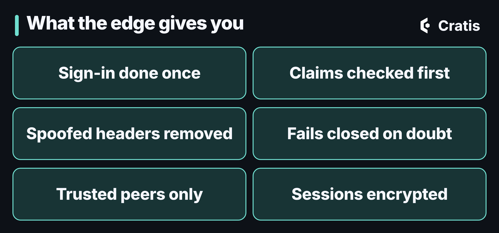
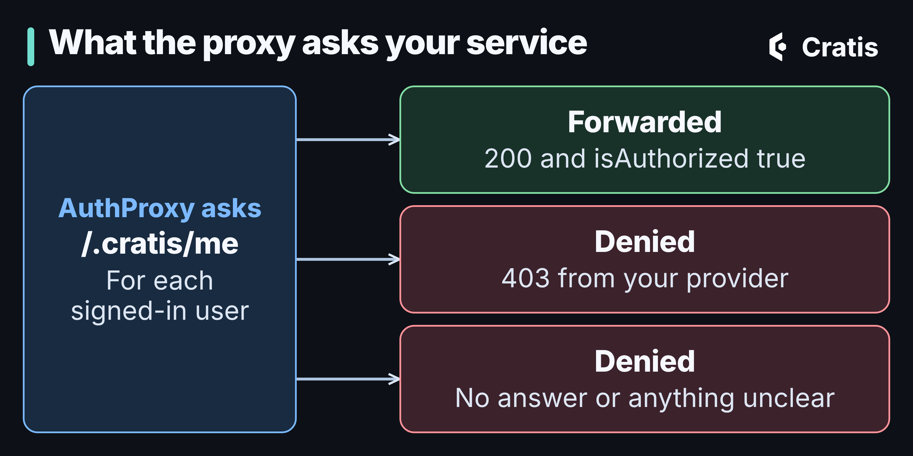

## TL;DR

[AuthProxy](https://cratis.io/authproxy/) is a container you configure and put in front of your services, at the ingress. It authenticates the request, resolves the tenant, enriches the identity and forwards it all as headers, so each service can assume it's looking at an authenticated, tenant-scoped request. It doesn't care what your services are written in. There's a nice Aspire integration for those who run Aspire, but at its core it's a container with configuration. Doing this at the edge is also a security win: one place for sign-in, claims checked before anything is forwarded, spoofed headers removed, and a default that fails closed. The price is a trust boundary, because your services believe the proxy. It works with Arc through Arc's `/.cratis/me` endpoint, and with [Ante](https://github.com/Cratis/Ante), the invitation and onboarding lobby, when someone is signed in but doesn't belong anywhere yet.

## The same chores in every service

Let's face it, nobody wants to write the sign-in handshake twice. Every application grows the same crop of edge concerns: who is this user, which tenant are they in, where does this request go, and how do you bring in somebody who's been invited but has no account yet. Without a gateway, every service re-implements them, and the copies drift. An OpenID Connect flow here, a tenant lookup there, an invite-acceptance flow in the third one.

AuthProxy is the gateway that owns those edges. It's a reverse proxy built on YARP, and there's no code to write. You configure it in the `Cratis:AuthProxy` section of `appsettings.json`, or with `Cratis__AuthProxy__` environment variables, and run it as a container in front of your services. It's standalone: it pairs naturally with Arc, but it will sit in front of any backend and frontend you point it at.


*Everything about who the caller is gets settled at the edge.*

## A container you configure

I want to get one thing across before anything else. AuthProxy is a container, the [`cratis/authproxy`](https://hub.docker.com/r/cratis/authproxy) image, and it doesn't care what your stack looks like. You configure it, and you put it in front of your services at the ingress level, which is the same place you'd put any other reverse proxy.

Everything it knows about your system is configuration. A service is a base URL for a backend, a frontend or both, and the proxy sends `/api/**` to the backend and everything else to the frontend. This is the quickstart from the repository, with Microsoft Entra ID sign-in and the tenant taken from the host:

```json
{
  "Cratis": {
    "AuthProxy": {
      "Authentication": {
        "OidcProviders": [
          {
            "Name": "Microsoft",
            "Type": "Microsoft",
            "Authority": "https://login.microsoftonline.com/<tenant-id>/v2.0",
            "ClientId": "<client-id>",
            "ClientSecret": "<client-secret>"
          }
        ]
      },
      "TenantResolutions": [
        {
          "Strategy": "Host"
        }
      ],
      "Services": {
        "main": {
          "Backend": {
            "BaseUrl": "http://backend:8080/"
          },
          "Frontend": {
            "BaseUrl": "http://frontend:3000/"
          }
        }
      }
    }
  }
}
```

That's all of it. Nothing in there says what the backend is written in, because it doesn't matter.


*A configured container at the front. Behind it, whatever you already run.*

A backend only has to speak HTTP. If it answers `GET /.cratis/me`, the proxy uses that to enrich the identity and to decide who may enter, and Arc answers it for you. If your service doesn't, you set `ResolveIdentityDetails` to `false` for that service and the proxy never calls it. A frontend is any single-page app or static site.

So where does Aspire come in? If you run Aspire, there's a `Cratis.AuthProxy.Aspire` package that wires the container into your AppHost with a fluent API, so you don't set the environment variables by hand. That's a convenience for that world. It's not a requirement, and it's not how the product works. The docs also have guides for running it on [Azure](https://cratis.io/authproxy/azure/) and for [Aspire](https://cratis.io/authproxy/aspire/).

Here's what it handles, in the order a request meets it:

- **Authentication.** OpenID Connect and OAuth 2.0, with one provider or several, plus JWT bearer. An unauthenticated request is challenged or sent to a provider-selection page.
- **Authorization.** You can require a claim, such as a role, a group, or a GitHub organization or team, before anything is forwarded. Authenticating everyone is not the same as letting everyone in.
- **Multi-tenancy.** The tenant is resolved per request, from the host, a subdomain, a claim, the route or a fixed value. [Part 10 of the series](/tenancy-and-identity-end-to-end/) follows that tenant hop by hop through Arc and Chronicle, so I won't repeat it here.
- **Identity enrichment.** The proxy calls an endpoint on your service and attaches the answer to the forwarded request.
- **Invitations and the lobby.** Invite-based onboarding with signed tokens, and a lobby for users who aren't assigned to a tenant yet.

## What putting it at the edge buys you

Sign-in and authorization are the part of an application where one copy beats ten. Doing them in a proxy at the ingress gives you things that are hard to get by convention:



*Six things you get from one well-placed container.*

- **Sign-in is done once.** One OpenID Connect handshake in one place, with Microsoft Entra ID, Google, GitHub, Apple or any other OIDC provider, instead of a copy in every service that slowly drifts.
- **Claims are checked before anything is forwarded.** Require a role, a group, or a GitHub organization or team, and a request without it never reaches your code.
- **Spoofed headers don't get through.** The proxy removes inbound identity and tenant headers before it sets its own, so a caller can't hand your service an identity of their own.
- **It fails closed.** Identity verification is required by default, which means only an explicit yes admits a user. More on that below.
- **It only believes the peers you name.** The client address and scheme come from forwarded headers, and the proxy trusts them only from [the proxies you declare](https://cratis.io/authproxy/configuration/trusted-proxies/). That's what the sign-in notifications and the `Secure` flag on cookies depend on.
- **Sessions and tokens are encrypted.** The authentication cookie, the sign-in cookies and the tokens it issues are all encrypted, with keys from [a key store you choose](https://cratis.io/authproxy/configuration/data-protection/). If you run more than one replica, they need a shared key store (the file system, Azure Blob or Redis), or users get signed out at random.
- **It can stay quiet.** The sign-in surface is public by default, because people have to reach it to sign in. A deployment that shouldn't be discoverable can use [capability-only admission](https://cratis.io/authproxy/configuration/admission/), where nothing answers anyone without a valid capability, and everyone else gets a plain 404.

None of that makes it a firewall, and it doesn't replace your own authorization. It does move the hardest-to-get-right code to one place, and it means your services start from a request that has already been vetted.

## Services trust the proxy

I want to be upfront about the trade-off, because it's the thing that makes the rest work. The identity and tenant reach your services as ordinary HTTP headers. Nothing in them is signed. A service believes them because of where they came from, not because of what they contain.

That puts the guarantee in your topology. AuthProxy removes any inbound copies of the identity and tenant headers before it sets its own, so a caller can't smuggle a principal through the proxy. But a backend that can be reached some other way has no such protection. Arc is built around that. By default it doesn't trust the forwarded identity headers, and requests stay anonymous, until you opt in. The [docs on generating a principal](https://cratis.io/arc/backend/csharp/development/generating-principal/) put the rule plainly: accept these headers only from a trusted authenticated ingress that strips and replaces them, with no bypass route to the backend.

The same thinking applies to the proxy's own surroundings. It almost never sees a browser. It sees an ingress controller, a load balancer or a CDN edge, and everything it knows about the client address and scheme comes from the forwarded headers those write. [You tell it which peers are allowed to speak for someone else](https://cratis.io/authproxy/configuration/trusted-proxies/), because nobody else can.

Here's the backend side for a service that uses Arc. The proxy doesn't care how a service is built, this is just the Arc flavor of one behind it:

```csharp
using Cratis.Arc;
using Cratis.Arc.Identity;

var builder = WebApplication.CreateBuilder(args);
builder.AddCratisArc(options => options.TrustForwardedIdentityHeaders = true);
builder.Services.AddMicrosoftIdentityPlatformIdentityAuthentication();
builder.Services.AddAuthorization();

var app = builder.Build();
app.UseAuthentication();
app.UseAuthorization();
app.UseCratisArc();
await app.RunAsync();

public record LibraryIdentity(string DisplayName);

public class LibraryIdentityProvider : IProvideIdentityDetails
{
    public Task<IdentityDetails> Provide(IdentityProviderContext context) =>
        Task.FromResult(new IdentityDetails(context.Name != "blocked", new LibraryIdentity(context.Name)));
}
```

The first line of the registration is the opt-in. The provider at the bottom is the enrichment, which brings me to how the proxy and Arc talk.

## How AuthProxy talks to Arc

Arc has a place for "details about the signed-in user that the token doesn't carry": an identity details provider. You implement `IProvideIdentityDetails`, and Arc serves what you return at `/.cratis/me`. AuthProxy calls that endpoint on your service and attaches the result to the request it forwards. You write the provider once, and every service behind the ingress benefits.

The endpoint is also a gate. `IsUserAuthorized` in the provider's result decides whether the user may enter the application at all. Here's what the endpoint above returns for a signed-in user, for one the provider turns away, and for a request with no principal (some headers left out):

```text
GET /.cratis/me  (principal: Jane)
HTTP/1.1 200 OK
Cache-Control: no-store, private
{"id":"user-1","name":"Jane","isAuthenticated":true,"isAuthorized":true,"roles":["anonymous","authenticated"],"details":{"displayName":"Jane"}}

GET /.cratis/me  (principal: blocked)
HTTP/1.1 403 Forbidden

GET /.cratis/me  (no principal)
HTTP/1.1 401 Unauthorized
```



*Only an explicit yes gets through.*

That last sentence is a deliberate change. AuthProxy's identity verification for a service now defaults to `Required`, where it used to be best effort. Under the old behavior, only a 403 refused a caller, so an unreachable service, a timeout or an unreadable answer let the request through, which meant the gateway was at its most permissive exactly when it knew the least. Now only an explicit `"isAuthorized": true` admits. The [upgrade note](https://cratis.io/authproxy/upgrading/identity-verification-required-by-default/) has the full table, and it names the opt-out for a service that needs the old behavior. A service whose identity endpoint is down stops being served, and that's the intent.

One caution that's easy to miss. The identity is presentation data. It tells the frontend who's here, and it can keep a user out of the application, but it doesn't authorize your commands and queries. Those are protected by Arc's own authorization, on the server, whatever the frontend shows. The [identity docs](https://cratis.io/arc/understanding-identity-and-access/) are blunt about it, and I agree with them.

Arc is available for the JVM and TypeScript as well, with the same `/.cratis/me` idea. The details of each are in the docs and in Part 10.

## Invitations, and where Ante fits

Authentication tells you who someone is. It doesn't tell you they belong. A user who has signed in but has no tenant needs somewhere to go, and that's what the lobby is for. AuthProxy handles three onboarding outcomes: [inviting a user into an existing organization](https://cratis.io/authproxy/configuration/lobby/invitation-to-organization/), [inviting a user to create a new one](https://cratis.io/authproxy/configuration/lobby/invitation-for-creating-organization/), and [letting a user register on their own](https://cratis.io/authproxy/configuration/lobby/registration/).

The invitation flow uses a bootstrap path, `/invite/<token>`. The proxy validates the signed token, stages the invitation with the lobby before the user authenticates, sends them to sign in, and then checks again after they come back, so a browser can carry the values but can't author them. By default, if the invitation's tenant matches the tenant resolved for the request, the user continues straight into the application. If it doesn't, they're sent to the lobby, when one is configured.


*From an invitation to a user in the right place.*

The other end of that is [Ante](https://github.com/Cratis/Ante). It's Cratis' invitation and onboarding lobby. It signs the tokens for invitations your application issues, records when an invitee accepts or registers on their own, and publishes those facts for your application to act on. It's built on Chronicle, so those facts are events. What it deliberately doesn't do is own the rest: your application decides who to invite, delivers the link, runs the authenticating proxy and provisions the tenant or the membership. Ante saying "accepted" means it published the fact, not that your system has finished setting anyone up.

I should be honest about where Ante is. Its own documentation says there is no verified standalone walkthrough yet, with a host, Chronicle, MongoDB and a validating proxy wired together, and it asks you to read [its security notes](https://github.com/Cratis/Ante/blob/main/Documentation/security.md) before you deploy. So treat the flow above as a description of how the pieces are meant to fit, and the Ante docs as the source for what it supports today.

## Where it stops

- AuthProxy isn't an identity provider. It signs users in with the providers you configure. It's also not a firewall or a replacement for network controls.
- It doesn't replace authorization in your services. It decides who gets in and with what identity, and your commands and queries still decide what they may do.
- The guarantee is a network one. If a service can be reached without going through the proxy, its trust in the headers is misplaced.
- It's configuration, not code, which is the point, but it also means the details live in the [configuration reference](https://cratis.io/authproxy/configuration/), and it's worth reading before you run it for real.

## Try it

The Arc half is easy to try on its own. Create a web project, add the `Cratis.Arc` package, and use the registration above. Then send a request to `/.cratis/me` with the three headers the proxy would send: `x-ms-client-principal` with a base64-encoded client principal, plus `x-ms-client-principal-id` and `x-ms-client-principal-name`. The docs show how to [build a principal for local development](https://cratis.io/arc/backend/csharp/development/generating-principal/). Only do that on a loopback host, never on something reachable from the internet.

For the proxy itself, run the `cratis/authproxy` container with the quickstart configuration above, pointing `Backend` and `Frontend` at your own services, and start from the [AuthProxy docs](https://cratis.io/authproxy/). There are guides for [hosting it with Aspire](https://cratis.io/authproxy/aspire/) and for [running it on Azure](https://cratis.io/authproxy/azure/) with Microsoft Entra ID sign-in.
