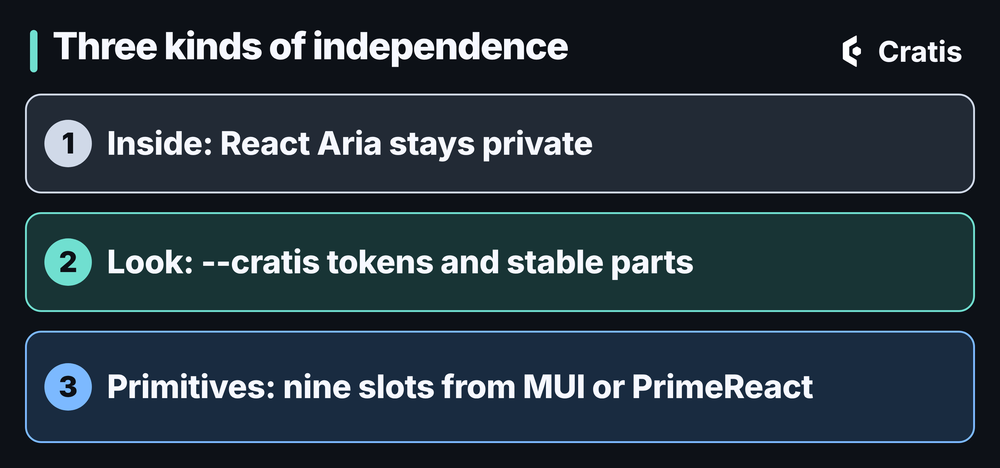

## TL;DR

[Cratis Components](https://www.cratis.io/components/) is the React layer between Arc's generated proxies and your screens. It owns the plumbing around commands and queries, so you don't rebuild it for every dialog and table. It's independent of any UI library in three ways: its interaction internals are private, its look is yours through tokens and stable parts, and optional adapters can swap a small set of primitives for MUI or PrimeReact. It isn't a promise that every component can be swapped for another library's, and it's React in a browser, nothing else.

## What sits between the proxy and the pixel

Arc gives you generated TypeScript for your commands and queries, and that's a great start. But a proxy is not a screen. Between the proxy and what the user sees there's a lot of work that looks the same in every application: running a command and tracking its state, showing validation where it belongs, a dialog that closes only when the command worked, a table that subscribes to a query and knows what to show when it's pending or empty.

That's what Components is for. The docs [put it](https://www.cratis.io/components/why-components/) as removing what you'd otherwise build in every application: command execution state, validation display, dialogs, observable subscriptions, paging, selection and empty states.


*Arc generates the contracts, you own the screens, and Components is the plumbing in between.*

One thing I like about that boundary is what Components doesn't do. It never fetches, caches or persists your data. Command execution and query results are Arc's state. And it has no direct dependency on Chronicle, so it behaves the same over an Arc backend that has no event sourcing at all. If you want the walk through a real screen, [Part 9 of the series](/cratis-components-the-react-layer/) builds the author list and the register dialog with it, and [command forms](/command-forms-link-the-command-focus-on-the-fields/) explains the form part.

## How it works

You import three stylesheets once, mount one provider inside Arc's, and then import every component from its own subpath. The package root is setup only. In the `cratis` template the stylesheets sit in the CSS entry file:

```css
@import '@cratis/components/tokens';
@import '@cratis/components/styles';
@import '@cratis/components/theme';
```

And the provider goes inside Arc's:

```tsx
import 'reflect-metadata';
import { Arc } from '@cratis/arc.react';
import { CratisComponentsProvider } from '@cratis/components';
import { YourApp } from './YourApp';

export const App = () => (
    <Arc>
        <CratisComponentsProvider value={{ locale: 'en-US' }} toaster>
            <YourApp />
        </CratisComponentsProvider>
    </Arc>
);
```

Components renders its own HTML. Simple controls are semantic native elements, and a few interaction details, such as focus, overlays and dates, come from React Aria inside the package. There's no UI library you have to install to get a working screen.

That is a change worth being honest about. Components 3 was built on PrimeReact, and installing it brought the PrimeReact dependency tree, its release cadence and its license terms, whether your own code imported PrimeReact or not. Components 4 removes that: its manifest declares no PrimeReact dependency, and a release gate checks that the emitted code has no PrimeReact imports. The reason in the [docs](https://www.cratis.io/components/ui-foundation/) is ownership. One token source instead of a translation chain through a third party's preset, a dependency and license boundary you control, and a public API that evolves on Components' own cadence.

## What "agnostic" actually covers

"Agnostic" is one of those words that promises more than it should, so let me say precisely what it means here. There are three layers, and they're different.



*Independent on the inside, in how it looks, and in a few primitives.*

**Inside.** React Aria does the focus, keyboard and overlay work, and none of its types, class names or DOM are part of what you depend on. If Components swaps it out later, you don't migrate. That's all "renderer-independent" means in the docs, and it's deliberately not more. The [accepted decision](https://www.cratis.io/components/decisions/0001-dom-coupled-contract/) says the public contract is coupled to React and the browser DOM on purpose, so you get real HTML attributes, refs and form behavior. A framework-neutral target, React Native or a terminal UI isn't what this is.

**Look.** Appearance is separated from behavior in three stylesheets: `tokens` defines the `--cratis-*` variables, `styles` is the structure, and `theme` is an optional baseline with dark mode. A product with its own design system skips the theme and maps its own values onto the tokens:

```css
:root {
    --cratis-primary-color: var(--product-accent);
    --cratis-surface-card: var(--product-surface);
    --cratis-text-color: var(--product-text);
    --cratis-focus-ring: var(--product-focus-ring);
}
```

For one component, documented parts carry a `data-cratis-part` attribute and take ordinary HTML attributes through a `pt` prop. The [styling guide](https://www.cratis.io/components/styling/) covers the cascade, and Part 9 covers the Tailwind trap.

**Primitives.** This is where MUI and PrimeReact come in. An optional adapter swaps in that library's version of a small set of primitives. You pick it on the provider:

```tsx
import { CratisComponentsProvider } from '@cratis/components';
import { muiUiLibrary } from '@cratis/components.mui';

export const Application = () => (
    <CratisComponentsProvider value={{ locale: 'en-US' }} library={muiUiLibrary}>
        <main>Application content</main>
    </CratisComponentsProvider>
);
```

There are [adapters for MUI, for PrimeReact 11 and for PrimeReact 10](https://www.cratis.io/components/renderers/). If you've heard that Components supports PrimeReact and MUI out of the box, this is the current shape: the built-in renderer is the default, and the adapters are optional packages that you install and version together with Components.

## What an adapter can't swap

This is the part I'd most like you to remember. An adapter covers exactly nine slots: button, icon button, text input, text area, checkbox, radio, switch, progress bar and surface. Dialogs, dropdowns, date pickers, tooltips and the table paginator stay with Components, and so do the composites. A `DataPage` under the MUI adapter is still a `DataPage`.


*Nine primitives can come from another library. The rest is Components.*

You can see that boundary in the markup. The same `<Button>Save</Button>` renders as an element with the class `cratis-button` by default, and with MUI's `MuiButton-root` classes under the adapter. Both keep the same `data-cratis-part="root"` and `data-variant="solid"` attributes. A command form behaves the same way: an empty title still gets the message from your C# rule under the right field with either renderer.

That's what I'd call agnostic without the hand-waving. The behavior is Components', the primitives can be someone else's, and the contract in between is stable. If a screen needs something a vendor grid does, the [adapter docs](https://www.cratis.io/components/renderers/unsupported/) point to using that grid next to Components, and not inside it.

## When not to use it

Use Components for screens that consume generated commands and queries. For a one-off element with no Cratis behavior, native HTML or your own component is the better answer, and the two mix without a fuss. The tables sort and filter the page that's loaded, so a filter over a whole result is still a query argument that the server applies. And if you're not on React in a browser, this isn't the library.

## Where to go next

Start with the [Components tutorial](https://www.cratis.io/components/tutorial/), which builds a live list-and-detail screen, and read Part 9 for what the template does with it. If you're coming from Components 3, the [migration guide](https://www.cratis.io/components/migration/3-to-4/) has the steps. And if you pick an adapter, install it at exactly the same version as `@cratis/components`, because each adapter release requires its own matching version.
