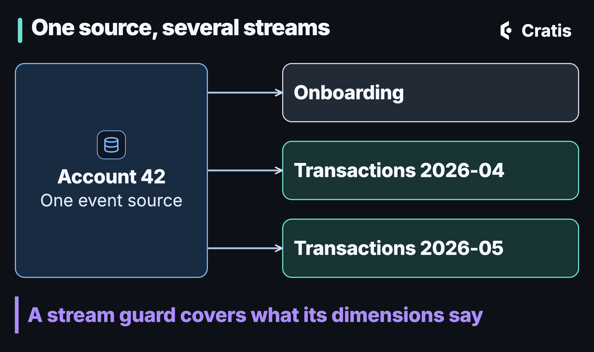

import { Tabs, TabItem } from '@astrojs/starlight/components';

## TL;DR

Dynamic Consistency Boundary (DCB) is a good idea with an awkward name. What I care about is smaller and easier to explain: model your events however the business needs, make it obvious which one thing owns the events it produces, and let that owner state, per command, what has to hold when it decides. Chronicle and Arc give you a tool for each, and Arc's new read protection (Arc 22.106, with Chronicle 19.71) makes the most common one a lot less ceremony. [Chronicle's own documentation](https://cratis.io/chronicle/dynamic-consistency-boundary/chronicle/) is upfront that it isn't a DCB event store, and that points at a better vocabulary.

The C# in this post uses .NET 10, Chronicle 19.73.1 and Arc 22.109.0.

## Why I'm retiring the acronym

In March I wrote about Dynamic Consistency Boundaries and how Chronicle fits, on my own blog. The core of the idea is good: a command reads the events it needs, remembers the position of the last one it saw, and appends only if nothing relevant has arrived since. The consistency boundary comes from what the decision used, not from an object you drew up front. The [DCB specification](https://dcb.events/) builds an event store around that, with tags on events as the way to say what an event concerns.

Chronicle doesn't do it that way, and the docs say so plainly: Chronicle "supports DCB-style decision models and append conditions within its event-source model. It is not a DCB event store." Each event has exactly one event source id, and tags you add yourself are labels and filters, not part of the consistency check. A fact about two entities is usually written as two events in one atomic append.

That's the reason for this post. I'm not asking anyone to stop reading about DCB. The spec is worth knowing, and my [constraints post](/invariants-at-write-time-with-chronicle-constraints/) from last week leaned on it. I'm asking us to stop using it as the name for what Chronicle does, because the name needs a footnote every time. "DCB" has a second problem too: it sounds like a theory you need to subscribe to before you can write a command. You don't. What you need is three things, and each of them has a plain name.


*Three things worth naming. None of them needs the acronym.*

This post takes them in turn, shows what Chronicle and Arc give you for each, and ends with where the Decider pattern fits and where it doesn't. The mechanisms themselves, constraints, scopes, decision reads and aggregates, are covered in depth in [Part 5 of the Script to stage series](/rules-that-hold-when-you-write/), and the [Decisions that hold](/the-bug-you-never-see/) series takes read protection one rule at a time. This one is about how they fit together and why.

## Flexibility in modeling

The point of drawing the consistency boundary at decision time, and not at design time, is that you don't have to guess your access patterns in advance. The classic aggregate root asks you to decide up front which facts belong together. Get it wrong and you either serialize things that never needed it or protect too little. Chronicle gives you smaller pieces to build the boundary from.

An event belongs to an **event source**, identified by an `EventSourceId` (or a typed `EventSourceId<T>`, so a book isn't a member in the type system either). On top of that you can add formalized, single-valued stream metadata: an event source type, an event stream type and an event stream id. A concurrency scope can filter on any of those, plus event types, and it can narrow or widen without touching the events themselves. Those four are different from [custom tags](https://cratis.io/chronicle/concepts/event-metadata-tags/): custom tags are stored and filterable, but they don't take part in consistency.

You can declare that structure once with an [event source definition](https://cratis.io/chronicle/event-sources/), which every client in the table below supports and which needs a Chronicle 19.30 kernel. Here an account has streams, and each stream says which dimensions an append to it is checked on. In C# Onboarding is one stream, and Transactions is one stream per month, so the month is part of what an append is checked against. The other tabs are the published declarations from each client's docs, with their own stream names:

<Tabs syncKey="language">
<TabItem label="C#">

```csharp
using Cratis.Chronicle.Events;
using Cratis.Chronicle.EventSequences;
using Cratis.Chronicle.EventSources;

[EventType]
public record MoneyDeposited(decimal Amount);

[EventSource("Account", Description = "A customer's bank account", Concurrency = ConcurrencyDimensions.EventSourceId)]
[EventStream("Onboarding", Description = "Opening the account and verifying the customer")]
[EventStream(
    "Transactions",
    Description = "Deposits and withdrawals, one stream per month",
    Concurrency = ConcurrencyDimensions.EventSourceId | ConcurrencyDimensions.EventStreamType | ConcurrencyDimensions.EventStreamId)]
public class AccountEventSource : IEventSource;

public static class Deposits
{
    public static Task<AppendResult> Deposit(IEventLog eventLog, EventSourceId accountId, decimal amount, string month) =>
        eventLog.Append<AccountEventSource>(
            accountId,
            new MoneyDeposited(amount),
            eventStream: "Transactions",
            eventStreamId: month);
}
```

</TabItem>
<TabItem label="Kotlin">

```kotlin
import io.cratis.chronicle.eventSources.ConcurrencyDimension
import io.cratis.chronicle.eventSources.EventSource
import io.cratis.chronicle.eventSources.EventStream

@EventSource(
    name = "Account",
    description = "A customer account",
    concurrency = [ConcurrencyDimension.EventSourceId],
    streams = [
        EventStream(
            name = "Transactions",
            description = "Money in and out",
            concurrency = [
                ConcurrencyDimension.EventSourceId,
                ConcurrencyDimension.EventStreamType
            ]
        ),
        EventStream("Settings")
    ]
)
class AccountEventSource
```

</TabItem>
<TabItem label="Java">

```java
import io.cratis.chronicle.eventSources.ConcurrencyDimension;
import io.cratis.chronicle.eventSources.EventSource;
import io.cratis.chronicle.eventSources.EventStream;

@EventSource(
    name = "Account",
    description = "A customer account",
    concurrency = ConcurrencyDimension.EventSourceId,
    streams = {
        @EventStream(
            name = "Transactions",
            description = "Money in and out",
            concurrency = {
                ConcurrencyDimension.EventSourceId,
                ConcurrencyDimension.EventStreamType
            }),
        @EventStream(name = "Settings")
    })
class AccountEventSource {
}
```

</TabItem>
<TabItem label="TypeScript">

```typescript
import { ConcurrencyDimensions, eventSource, eventStream } from '@cratis/chronicle';

@eventSource({ name: 'Account', description: 'A bank account', concurrency: ConcurrencyDimensions.eventSourceId })
@eventStream('Transactions', { description: 'Money movements' })
class AccountEventSource {}
```

</TabItem>
<TabItem label="Elixir">

```elixir
defmodule MyApp.AccountEventSource do
  use Chronicle.EventSources.EventSource,
    name: "Account",
    description: "A bank account",
    concurrency: [:event_source_id]

  stream "Transactions",
    description: "Money movements",
    concurrency: [:event_source_id, :event_stream_id]
end
```

</TabItem>
</Tabs>

A deposit in April and a deposit in May don't contend. The guard is asymmetric, though: a deposit doesn't look at onboarding events, but an onboarding append is checked against every event of the account, deposits included. The first deposit into a brand-new month has nothing to compare against, so by default it isn't checked at all; you opt in with `CheckFirstAppendIntoAScope` or `ExpectingNoMatchingEvent()` (`withExpectsNoMatchingEvent()` in Kotlin and Java, `EventSequenceNumber.beforeFirst` in TypeScript, `check_first_append` or `ConcurrencyScope.expecting_no_matching_event/1` in Elixir). Nobody had to restructure an aggregate to get this shape, and you can change which dimensions guard an append by editing the declaration. Events that are already stored keep the stream names they were written with. The [event source docs](https://cratis.io/chronicle/event-sources/concurrency/) show the full conflict table.



*One identity, several streams. Each stream's guard covers the dimensions it declares.*

You can also build a scope by hand when you need one. It states what an append expects about the history it was decided on: a position, plus the event source, stream and event types that matter. Narrower scopes mean fewer false conflicts. Each tab builds a scope from a position and a stream type, and the C#, TypeScript and Elixir ones also name the event types it watches. The `15` stands for the tail position you captured before reading:

<Tabs syncKey="language">
<TabItem label="C#">

```csharp
using Cratis.Chronicle.Events;
using Cratis.Chronicle.EventSequences;
using Cratis.Chronicle.EventSequences.Concurrency;

[EventType]
public record ConcurrencyMoneyDeposited(decimal Amount);

[EventType]
public record ConcurrencyMoneyWithdrawn(decimal Amount);

public class ConcurrencyAccountTransactionService(IEventLog eventLog)
{
    public async Task ProcessTransaction(EventSourceId accountId, decimal amount)
    {
        var concurrencyScope = new ConcurrencyScopeBuilder()
            .WithEventSourceId(accountId)
            .WithSequenceNumber(15)
            .WithEventStreamType("Transactions")
            .WithEventType<ConcurrencyMoneyDeposited>()
            .WithEventType<ConcurrencyMoneyWithdrawn>()
            .Build();

        await eventLog.Append(
            accountId,
            new ConcurrencyMoneyDeposited(amount),
            concurrencyScope: concurrencyScope);
    }
}
```

</TabItem>
<TabItem label="Kotlin">

```kotlin
import io.cratis.chronicle.IEventStore
import io.cratis.chronicle.events.EventType
import io.cratis.chronicle.eventSequences.AppendOptions
import io.cratis.chronicle.eventSequences.EventSequenceNumber
import io.cratis.chronicle.eventSequences.concurrency.ConcurrencyScopeBuilder

@EventType
data class ConcurrencyMoneyDeposited(val amount: Double = 0.0)

suspend fun processTransaction(store: IEventStore, accountId: String, amount: Double) {
    val concurrencyScope = ConcurrencyScopeBuilder()
        .withEventSourceId()
        .withSequenceNumber(EventSequenceNumber(15))
        .withEventStreamType("Transactions")
        .build()

    store.eventLog.append(
        accountId,
        ConcurrencyMoneyDeposited(amount),
        AppendOptions(eventStreamType = "Transactions", concurrencyScope = concurrencyScope)
    )
}
```

</TabItem>
<TabItem label="Java">

```java
import io.cratis.chronicle.EventStore;
import io.cratis.chronicle.events.EventType;
import io.cratis.chronicle.eventSequences.AppendOptions;
import io.cratis.chronicle.eventSequences.AppendResult;
import io.cratis.chronicle.eventSequences.concurrency.ConcurrencyScope;
import io.cratis.chronicle.eventSequences.concurrency.ConcurrencyScopeBuilder;

import io.cratis.chronicle.java.AppendOptionsBuilder;
import io.cratis.chronicle.java.ConcurrencyScopeBuilderJavaBridge;
import io.cratis.chronicle.java.EventLogJavaBridge;

@EventType
record ConcurrencyMoneyDeposited(double amount) {}

class EventsConcurrencyBuilder {
    AppendResult processTransaction(EventStore store, String accountId, double amount) {
        ConcurrencyScope concurrencyScope = ConcurrencyScopeBuilderJavaBridge
            .withSequenceNumber(new ConcurrencyScopeBuilder(), 15)
            .withEventSourceId()
            .withEventStreamType("Transactions")
            .build();

        AppendOptions options = new AppendOptionsBuilder()
            .eventStreamType("Transactions")
            .concurrencyScope(concurrencyScope)
            .build();

        return EventLogJavaBridge.append(store.getEventLog(), accountId, new ConcurrencyMoneyDeposited(amount), options);
    }
}
```

</TabItem>
<TabItem label="TypeScript">

```typescript
import { eventType, getEventTypeFor, IEventLog } from '@cratis/chronicle';
import { field } from '@cratis/fundamentals';

@eventType()
class ConcurrencyMoneyDeposited {
    @field(Number) readonly amount: number;

    constructor(amount: number) {
        this.amount = amount;
    }
}

@eventType()
class ConcurrencyMoneyWithdrawn {
    @field(Number) readonly amount: number;

    constructor(amount: number) {
        this.amount = amount;
    }
}

class ConcurrencyAccountTransactionService {
    constructor(private readonly eventLog: IEventLog) {}

    async processTransaction(accountId: string, amount: number): Promise<void> {
        await this.eventLog.append(accountId, new ConcurrencyMoneyDeposited(amount), {
            concurrencyScope: {
                sequenceNumber: 15n,
                eventStreamType: 'Transactions',
                eventTypes: [getEventTypeFor(ConcurrencyMoneyDeposited), getEventTypeFor(ConcurrencyMoneyWithdrawn)]
            }
        });
    }
}
```

</TabItem>
<TabItem label="Elixir">

```elixir
defmodule MyApp.Events.ConcurrencyMoneyDeposited do
  use Chronicle.Events.EventType, id: "concurrency-money-deposited"

  defstruct [:amount]
end

defmodule MyApp.Events.ConcurrencyMoneyWithdrawn do
  use Chronicle.Events.EventType, id: "concurrency-money-withdrawn"

  defstruct [:amount]
end

defmodule MyApp.ConcurrencyAccountTransactionService do
  alias Chronicle.Events.ConcurrencyScope
  alias MyApp.Events.{ConcurrencyMoneyDeposited, ConcurrencyMoneyWithdrawn}

  def process_transaction(account_id, amount) do
    # Pipe-able builder helpers compose a scope step by step.
    scope =
      15
      |> ConcurrencyScope.new()
      |> ConcurrencyScope.with_event_source()
      |> ConcurrencyScope.with_event_stream_type("Transactions")
      |> ConcurrencyScope.with_event_types([ConcurrencyMoneyDeposited, ConcurrencyMoneyWithdrawn])

    Chronicle.append(account_id, %ConcurrencyMoneyDeposited{amount: amount},
      concurrency_scope: scope
    )
  end
end
```

</TabItem>
</Tabs>

The default differs by client, and that matters more than the syntax. The .NET client checks the window between its tail read and the write unless you say otherwise. The Kotlin, Java, TypeScript and Elixir clients send no check unless you give the append a scope. In .NET, a scope you build yourself from a stream that had no events yet, so there was no position to capture, is checked as "no matching event yet" since Chronicle 19.68 instead of being skipped; `ConcurrencyOptions.SkipIncompleteExplicitScopes` restores the old skip. The [client differences page](https://cratis.io/chronicle/clients/where-the-clients-differ/) has the details. Even in .NET, that default only covers the short window at commit. It doesn't bind a decision to the state you read before it, which is the whole subject of the third section.

## One clear owner for every event

Flexibility on its own turns into a mess. Once events can be shaped any way you like, the question that keeps a codebase understandable is who is allowed to say that this happened.

My answer is one owner: the command that produces an event, with the event source deciding which stream the event joins. Every event type belongs to the slice that produces it, and the rules for producing it live there too. In a Cratis application that's a house convention (the event type is declared in the slice that appends it), and Chronicle's event source model backs it up from the other side: an event has exactly one event source id, so there's exactly one stream whose history it becomes part of.

That's a deliberate limit, and it has a cost. A fact about two entities, say a member taking a loan that affects both the member and the book, is usually two events, one for each event source, appended together in one atomic `AppendMany`. That's fine when each is a fact in its own entity's story, a loan on the member and a copy taken from the book. DCB's tags would let you write one event and tag it with both, and this is the one place where Chronicle gives that up. When it's really the same fact twice, the [Chronicle docs](https://cratis.io/chronicle/dynamic-consistency-boundary/chronicle/) suggest looking for one event on one source with a decision read over the other. In practice the limit keeps ownership readable. You never have to ask which of three concepts an event "really" belongs to.

In Arc the owner is the command, and the command's return value is the proof. `Handle()` returns the events, Arc appends them in the command's transaction, and if you return several `EventForEventSourceId` values they commit together or not at all. There's no `IEventLog` injected into the middle of business logic. The same goes for an Arc aggregate root, which is an owner with explicit state: it rehydrates from its own entity's stream and commits what it applied. Same idea, different amount of ceremony.

## Rules that belong to the command

This is where most of the confusion sits, so I'll slow down. The question isn't which feature to use. It's what kind of rule you have, because different rules need different guards, and the wrong tool fails silently. The command runs, nobody sees an error, and the rule is broken anyway.


*The rule decides the tool. Chronicle's [choosing guide](https://cratis.io/chronicle/dynamic-consistency-boundary/choosing/) and Arc's [consistency page](https://cratis.io/arc/backend/csharp/chronicle/consistency/) carry the full matrix.*

### Uniqueness belongs to the store

A value that must be unique, a username or an email or an ISBN, is the one rule that's best not decided in a command at all. A constraint is checked by the Chronicle kernel when the event is appended, for every writer, and an append that would break it is rejected. It's a cheap check, every client in the table below has constraints, and it's why they sit first on every list. I wrote about them in [Invariants at write time](/invariants-at-write-time-with-chronicle-constraints/), and [Part 5](/rules-that-hold-when-you-write/) shows the declaration in each client. This is what it looks like on an event in C#:

```csharp
using Cratis.Chronicle.Events;
using Cratis.Chronicle.Events.Constraints;
using Cratis.Concepts;

public record ProjectName(string Value) : ConceptAs<string>(Value);

public record ProjectDescription(string Value) : ConceptAs<string>(Value);

[EventType]
public record ProjectCreated([property: Unique] ProjectName Name, ProjectDescription Description);
```

### A rule over state: the read you decide from

Everything else that depends on state needs a read, and here's the trap. A read model is an answer to "what does this look like now?" It was never promised to be the state a decision was made on. A materialized read model can lag. A passive one is fresh at the moment you read it, but it doesn't remember where the log was, so an event that lands between your read and your append goes unnoticed. Arc's [validators page](https://cratis.io/arc/backend/csharp/chronicle/consistency/validators/) lays out the sequence: two members borrow the last copy at the same time, both validators read one available, both pass, both events are appended.

This is the part my March post got wrong, and I'd rather fix it in public. It showed a validator reading a read model to enforce a business rule and presented that as the DCB way. In Chronicle and Arc as they were then, that guarded nothing, and the post also described the default append check incorrectly. Since then Arc has changed what that pattern can mean, which I'll get to in a moment. A read model is still the right thing for a hint on screen. By default it's still the wrong thing to decide from.


*The difference is the position. A decision read notes where the log was before it read.*

A [decision read](https://cratis.io/chronicle/read-models/decision-reads/) folds a flat projection from the log in a fresh session and notes the log position first. The append it guards is then rejected if a matching event arrived after that position. An absent model is guarded too, so a concurrent creation conflicts. Decision reads need Chronicle 19.9 or later, and in Arc you opt a command in with `[ProtectedDecision]` from Arc 22.39, take the state as `DecisionRead<T>`, and return the event, or a `Result` that declines:

<Tabs syncKey="language">
<TabItem label="C#">

```csharp
using Cratis.Arc.Chronicle.ReadModels;
using Cratis.Arc.Commands.ModelBound;
using Cratis.Arc.Validation;
using Cratis.Chronicle.Events;
using Cratis.Chronicle.Projections.ModelBound;
using Cratis.Chronicle.ReadModels;
using Cratis.Concepts;
using Cratis.Monads;

public record MemberId(Guid Value) : ConceptAs<Guid>(Value);

[EventType]
public record CopyAdded();

[EventType]
public record BookBorrowed(MemberId MemberId);

[EventType]
public record BookReturned();

public record BookStock(
    EventSourceId Id,
    [Increment<CopyAdded>, Decrement<BookBorrowed>, Increment<BookReturned>] int Available);

[Command]
[ProtectedDecision]
public record BorrowBook(EventSourceId BookId, MemberId MemberId)
{
    public Result<BookBorrowed, ValidationResult> Handle(DecisionRead<BookStock> stock) =>
        stock.Instance is not { Available: > 0 }
            ? ValidationResult.Error("No copies of this book are available.")
            : new BookBorrowed(MemberId);
}
```

</TabItem>
<TabItem label="Kotlin">

Kotlin does not support decision reads yet.

</TabItem>
<TabItem label="Java">

Java does not support decision reads yet.

</TabItem>
<TabItem label="TypeScript">

TypeScript does not support decision reads yet.

</TabItem>
<TabItem label="Elixir">

Arc for Elixir doesn't exist. With the Chronicle Elixir client, `Chronicle.decide/2` runs the read and the guarded append in one unit of work:

```elixir
Chronicle.decide(fn _unit_of_work ->
  {:ok, read} = Chronicle.ReadModels.DecisionReads.get(MyApp.ReadModels.Seat, "seat-5")

  if read.instance == nil do
    Chronicle.EventSequences.EventLog.append("seat-5", %SeatBooked{by: "alice"})
  end
end)
```

</TabItem>
</Tabs>

If two members race for the last copy, the second one gets a validation result with the reason `concurrencyViolation`. Nothing is appended, and Arc and Chronicle don't re-run the command. The caller reads again and resubmits. That cost is real: a decision read folds the key's whole history on every attempt, and the docs advise keeping keys short-lived (a key per period, per order, per booking) and flat. It guards the event log for the keys it reads. Revisions, redactions, other event sequences and data from outside Chronicle aren't covered. When the rule is about one routed stream of raw events, Arc's [stream decisions](https://cratis.io/arc/backend/csharp/chronicle/commands/stream-decisions/) do the same job without folding a projection.

#### Read protection: the same guard, without the ceremony

Arc 22.106 added a second way to get the same guard, and for most commands it's the one I'd reach for first. With read protection switched on, a read model you take as a parameter of a command or its validator is read the way a decision read is: fresh, with the log position noted first. If anything it read changed before the commit, nothing is written and the caller gets a 400 with the same `concurrencyViolation`, the detail `ReadChanged`, and a message saying which read model changed: "BookStock 'isbn-1' changed after BorrowBook read it. Nothing from this command was written; submit it again." It needs Chronicle 19.71 or later, and it's off by default, so nothing changes until you ask. New applications from the Cratis templates start with it `On`. You turn it on for the whole assembly with `<CratisReadProtection>On</CratisReadProtection>`, or for one command with `[ReadProtection(ReadProtectionMode.On)]`. There's a `Measure` mode that changes no behavior and reports what `On` would guard or refuse, which is how I'd adopt it in an existing application.

The practical difference is where the rule lives. With a protected decision it's in `Handle()`. With read protection the rule can sit in an ordinary `CommandValidator<T>`, the read model arrives as a constructor parameter, and `Handle()` only says what happens:

```csharp
using Cratis.Arc.Commands;
using Cratis.Arc.Commands.ModelBound;
using Cratis.Arc.Queries.ModelBound;
using Cratis.Chronicle.Events;
using Cratis.Chronicle.Projections.ModelBound;
using Cratis.Concepts;
using FluentValidation;

public record Isbn(string Value) : EventSourceId(Value);

public record MemberId(Guid Value) : ConceptAs<Guid>(Value);

[EventType]
public record CopyAdded();

[EventType]
public record BookBorrowed(MemberId Member);

[EventType]
public record BookReturned(MemberId Member);

[ReadModel]
public record BookStock(
    Isbn Id,
    [Increment<CopyAdded>, Decrement<BookBorrowed>, Increment<BookReturned>] int Available);

[Command, ReadProtection(ReadProtectionMode.On)]
public record BorrowBook(Isbn Isbn, MemberId Member)
{
    public BookBorrowed Handle() => new(Member);
}

public class BorrowBookValidator : CommandValidator<BorrowBook>
{
    public BorrowBookValidator(BookStock? stock) =>
        RuleFor(command => command.Isbn)
            .Must(_ => stock is { Available: > 0 })
            .WithMessage("No copies of this book are available.");
}
```

`BookStock?` is nullable because a book with no events has no read model yet; a non-nullable parameter refuses the command before any rule runs. Let convention discovery register the validator: under `On`, one you register by hand as scoped, as a singleton, through a factory or as an instance is refused.

That's the March pattern, and under `On` it holds. The same code under the default `Off` is a plain read again, which is why I'd rather the mode be visible on the command than hidden in a build property you forget about. When a read is meant as a hint, `[Unprotected("why")]` says so, and under `On` reads Arc can't protect, such as a raw event log read, are refused with a message that says why. From Arc 22.108, a command declared `On` also blocks on validator errors whatever severity the caller asks to allow with `X-Allowed-Severity`; under `Off` and `Measure` a caller can drop them unless the command declares `[BlockOnValidationSeverity(ValidationResultSeverity.Error)]`. `[ProtectedDecision]` and `DecisionRead<T>` keep working, but under `On` you don't need them.

It's .NET only, like `[ProtectedDecision]`. The [Arc getting started guide](https://cratis.io/arc/backend/csharp/chronicle/consistency/getting-started/) walks through it and [adopting read protection](https://cratis.io/arc/backend/csharp/chronicle/consistency/adopting/) covers `Measure`. The cost is the one decision reads have: the read folds the history it covers on every attempt, and nothing re-runs the command for you.

Chronicle 19.71 also fixed the cost problem I mentioned for long histories. A read model can declare the one stream that defines its state with `[EventStream<TSource>(stream)]`, say a month of withdrawals. Taken as a plain parameter, it's read from the stream the command's route points to, so October's withdrawals don't make November's command conflict. That's the "key per period" advice, without inventing a key. Arc's [one stream](https://cratis.io/arc/backend/csharp/chronicle/consistency/scenarios/per-stream/) scenario has the monthly-limit example.

### Validators check the input, and with read protection a bit more

Validation is the one most people already know, and it keeps its job. A validator checks the shape of the input, and a shape check has no state to race. Arc 22.106 adds one thing: under read protection `On`, a validator that takes a read model also guards that read, which the section above shows. In C# that's `CommandValidator<T>` and `ConceptValidator<T>` with FluentValidation rules, which Arc also maps into the generated TypeScript proxies so the browser can check the same thing. Arc for Kotlin and Java has a `CommandValidator` and its own validators, and Arc's frontend core has a `ruleFor` API that mirrors the common rules. The rule of thumb is the same in all of them:

<Tabs syncKey="language">
<TabItem label="C#">

```csharp
using Cratis.Arc.Commands;
using FluentValidation;

public class BorrowBookValidator : CommandValidator<BorrowBook>
{
    public BorrowBookValidator() =>
        RuleFor(command => command.MemberId)
            .NotEmpty()
            .WithMessage("A member is required.");
}
```

</TabItem>
<TabItem label="Kotlin">

```kotlin
@Component
class CreateTaskValidator : CommandValidator<CreateTask> {
    override val commandType = CreateTask::class.java

    override suspend fun validate(command: CreateTask, context: CommandContext): List<ValidationResult> =
        if (command.title.isBlank()) {
            listOf(ValidationResult.error("A task title is required.", listOf("title")))
        } else {
            emptyList()
        }
}
```

</TabItem>
<TabItem label="Java">

```java
public class CreateTaskValidator implements BlockingCommandValidator<CreateTask> {
    @Override
    public Class<CreateTask> getCommandType() {
        return CreateTask.class;
    }

    @Override
    public List<ValidationResult> validate(CreateTask command, CommandContext context) {
        if (command.title().isBlank()) {
            return List.of(ValidationResult.error("A task title is required.", List.of("title")));
        }
        return List.of();
    }
}

@Configuration
class ValidationConfiguration {
    @Bean
    CommandValidator<CreateTask> createTaskValidator() {
        return new BlockingCommandValidatorAdapter<>(new CreateTaskValidator());
    }
}
```

</TabItem>
<TabItem label="TypeScript">

```typescript
class CreateUserCommandValidator extends CommandValidator<ICreateUserCommand> {
    constructor() {
        super();
        this.ruleFor(c => c.email).notEmpty().emailAddress();
        this.ruleFor(c => c.age).greaterThanOrEqual(18);
        this.ruleFor(c => c.name).minLength(2).maxLength(50);
    }
}
```

</TabItem>
<TabItem label="Elixir">

Arc for Elixir doesn't exist.

</TabItem>
</Tabs>

A validator can take a read model as a constructor dependency, and it'll run. Whether it guards anything depends on the mode. Under read protection `On` it does, as above. Under the default `Off`, and under `Measure`, it doesn't, and outside `On` a `[ProtectedDecision]` command only accepts validators with a single parameterless constructor, refusing the rest when the command runs. So the split is clean for a protected decision: the validator says whether the input is well formed, `Provide()` fetches data, and `Handle()` decides, returning events or a `Result<TEvent, ValidationResult>` that declines whatever severity the caller allows. With read protection you can instead put the state-dependent rule in the validator. The Arc page on [validators and consistency](https://cratis.io/arc/backend/csharp/chronicle/consistency/validators/) has the full table.

### Aggregates are one owner with its own state

I haven't forgotten aggregate roots. Arc has them, for .NET only, and the docs treat them as a legitimate choice for rich behavior: many rules over one lifecycle, where "withdraw 200" has to be checked against this account's own history. An aggregate root rehydrates from its entity's events, applies new facts under its own rules, and commits them as one unit.

```csharp
using Cratis.Arc.Chronicle.Aggregates;
using Cratis.Chronicle.Events;
using Cratis.Concepts;

public record OrderId(Guid Value) : EventSourceId<Guid>(Value)
{
    public static readonly OrderId NotSet = new(Guid.Empty);

    public static OrderId New() => new(Guid.NewGuid());
    public static implicit operator OrderId(Guid value) => new(value);
}

public record ProductId(Guid Value) : EventSourceId<Guid>(Value)
{
    public static readonly ProductId NotSet = new(Guid.Empty);

    public static ProductId New() => new(Guid.NewGuid());
    public static implicit operator ProductId(Guid value) => new(value);
}

public record Quantity(int Value) : ConceptAs<int>(Value)
{
    public static readonly Quantity NotSet = new(0);

    public static implicit operator Quantity(int value) => new(value);
}

public class Order : AggregateRoot
{
    int _quantity;

    public async Task AddItem(ProductId productId, Quantity quantity)
    {
        if (quantity <= 0 || quantity > 100 - _quantity)
        {
            Failed("Quantity must be positive and the order total must not exceed 100.");
            return;
        }

        await Apply(new ItemAdded(productId, quantity));
    }

    public void OnItemAdded(ItemAdded @event) => _quantity += @event.Quantity;
}

[EventType]
public record ItemAdded(ProductId ProductId, Quantity Quantity);
```

Arc takes the stream's position when it rehydrates and guards the commit with a scope built from it, so an aggregate rests on scopes, not on decision reads. It's a good fit when the rules belong together on one key. It's more than you need when one counter rule would do, and the docs say as much. They also say you can't mix an aggregate with `[ProtectedDecision]` on the same command. Under read protection `On`, a command can take an aggregate and a read model of a different source; a read of the aggregate's own source is refused.

## Where the Decider fits

If you know Jérémie Chassaing's [Decider pattern](https://thinkbeforecoding.com/post/2021/12/17/functional-event-sourcing-decider), here's where I'd place all this. A decider is a decide function from a command and a state to events, an evolve function from a state and an event to a new state, an initial state, and a way to tell when the process is finished. Nothing in the Cratis docs calls Chronicle or Arc a decider, so this mapping is mine, and I'd say a protected-decision command reminds me of one more than it implements one.


*Where the four parts of a decider land. The fit is loose, and the gaps matter.*

`decide` is `Handle()`, with the state coming in as `DecisionRead<T>` and the events going out as the return value. With read protection it can also be a validator over a read-model parameter plus a `Handle()` that says what happens, which is a looser fit. `evolve` is the projection that builds the state, or an aggregate's `On` methods. The initial state is the absent model: `Instance` is null, and an absent model is guarded too. The nearest thing to a terminal state is [closing a stream](https://cratis.io/chronicle/closing-streams/), which the kernel enforces as a constraint.

The differences matter. A decider composes: you can combine two and map over them. Chronicle doesn't offer that, and a decision read refuses projections that join entities, so a rule over two keys is two decision reads (with read protection, two read-model parameters with `[LookUpBy]`) and one or two events in one `AppendMany`. The guard lives in the store as the append condition and not in the decider's type. Uniqueness, which a decider can't express without the whole set of values as its state, sits outside it entirely as a constraint. And a decision read folds the key's history from the log on every attempt, where a decider's state is just whatever you carried forward. So if "decider" helps you design a command, use it. I wouldn't promise anyone the whole pattern.

## What each client has

The three capabilities don't arrive at the same time in every language. This is what's in the released clients and Arc ports named here:

| Capability | .NET | Kotlin / Java | TypeScript | Elixir |
| --- | --- | --- | --- | --- |
| Constraints (`unique`) | Yes | Yes | Yes | Yes |
| Concurrency scopes | Yes | Yes | Yes | Yes |
| Default append check | Optimistic tail read | None | None | None |
| Event source definitions | Yes | Yes | Yes | Yes |
| Decision reads | Yes | No | No | Yes |
| Closing-stream constraint | Yes | No | No | Yes |
| Read protection (`[ReadProtection]`, Arc 22.106) | Arc for .NET | No | No | No Arc |
| `[ProtectedDecision]`, aggregate roots | Arc for .NET | No | No | No Arc |
| Command validators | `CommandValidator<T>`, `ConceptValidator<T>` | `CommandValidator`, `ConceptValidator` | Arc's frontend core only | No Arc |

If you're not on .NET, the practical advice is the same one the docs give: use constraints for uniqueness, pass an explicit scope built from a position you captured before you read, and keep rules that need a decision read in a .NET service for now. Plainly: the clients aren't interchangeable, and the decision capabilities haven't reached all of them yet.

## What to do on Monday

You don't need to adopt anything to use this. For the next command you write, ask three questions.

- **Who owns this?** Which slice produces the event, and is it the only one? If a fact concerns two entities, are you ready to write two events in one append?
- **What has to hold when it's decided?** Name the rule. Is it a unique value, a rule over one key's history, a conflict between two people editing, or something that's fine to repair afterward?
- **Which row of [Arc's decision matrix](https://cratis.io/arc/backend/csharp/chronicle/consistency/) is that?** Constraint, decision read, stream decision, explicit scope, aggregate or a repair. If your answer is "I read a read model first", either turn on read protection for that command or accept that you're shipping a hint and calling it a rule.

From there, [Part 5](/rules-that-hold-when-you-write/) goes deep on each mechanism, the [consistency page in Arc's docs](https://cratis.io/arc/backend/csharp/chronicle/consistency/) has the decision matrix and the list of failures that are silent, and the [Chronicle DCB page](https://cratis.io/chronicle/dynamic-consistency-boundary/) is the place to start if you want the original idea. Tell me where this is still confusing on [Discord](https://discord.gg/kt4AMpV8WV).
