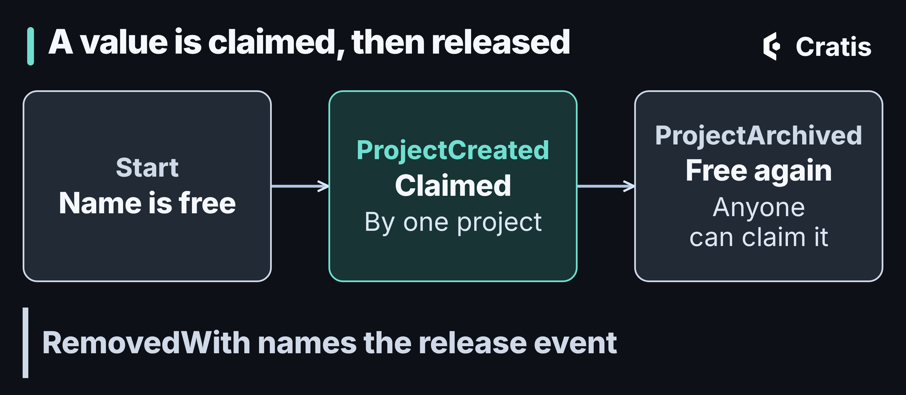

import { Tabs, TabItem } from '@astrojs/starlight/components';

## TL;DR

A [constraint](https://cratis.io/chronicle/constraints/) is a rule the Chronicle kernel checks when an event is appended, before it's committed. It's how you say "this username is taken" without racing a read model, and it's Chronicle's concrete tool for the idea behind the Dynamic Consistency Boundary: the decision, not an aggregate, decides what has to be consistent. A violation comes back as an outcome of the append, not as an exception.

## Two commands, one username

Sooner or later every event-sourced system runs into the same question. Two commands both want to register the same username, and only one of them can win.

In a CRUD system you'd put a unique index on the column and let the database sort it out. I've always liked that about relational databases, to be honest. In an event-sourced system the equivalent move isn't obvious. The log is append-only, the read model you'd check against is eventually consistent, and by the time the append reaches the store the decision has already been made.

Chronicle's answer is **constraints**. This post walks through what they are, why they sit where they sit, and how they connect to the Dynamic Consistency Boundary. If you want the whole set of tools for write-time rules side by side, [Part 5 of the series](/rules-that-hold-when-you-write/) does that. This one is about the idea underneath.

## The check you can't trust

The obvious approach is to read before you write. Query the read model, see that the email is free, append `UserRegistered`. The trouble is the gap between those two steps. Projections update *after* the append, usually within milliseconds, but "usually" isn't a guarantee. Two commands can both read the email as free, both decide to register, and both append. Nothing on the read path ever notices.

The traditional fix is to tighten the consistency scope until the race goes away. Load the whole aggregate, make the decision against it, and let optimistic concurrency serialize the contenders. For decisions that really belong to one entity, that's the right shape. But "this username is taken" isn't about one user. It's about every user that has ever registered, and an aggregate per user can't see that.

## The boundary belongs to the decision

The [Dynamic Consistency Boundary](https://cratis.io/chronicle/dynamic-consistency-boundary/) (DCB) flips the usual arrangement. Instead of "here's my aggregate, every decision about it gets serialized", it says: for *this* decision, take exactly the facts the decision depends on, keep those consistent, and let everything else stay independent. The boundary is drawn per decision, at runtime, and it can be narrower or wider than any aggregate would have been.


*The fixed boundary can't see the other users. The decision's boundary is made of exactly the facts it needs.*

That's the theory. A runtime still has to give you something concrete, and for write-time invariants that something in Chronicle is the constraint. You state the invariant up front, and the kernel enforces it against the authoritative event store when the append arrives. The decision may have been made against a read model that lags, but the check doesn't lag, because it runs where the events actually live.

## Constraints in Chronicle

A constraint is a server-side rule. When a client appends an event, the kernel checks the rule against the store. If it holds, the event is committed. If it doesn't, the append is rejected, for that client and every other client, because there's only one place appends happen.

Chronicle supports three kinds:

- A **unique property** constraint keeps a value unique across all events of one or more event types. The username case, or an order reference.
- A **unique event type** constraint allows only one event of a given type per event source. The `UserRegistered` case, where a second registration for the same person should simply be impossible.
- A **closing stream** constraint closes a stream when an event of a given type is appended, so later appends to it are rejected. It's a bit of a different animal, and the [docs cover it](https://cratis.io/chronicle/constraints/).

One thing to know about scope: a constraint is checked within the event sequence the event is appended to, in the namespace it's appended in. Each tenant gets its own set of unique values, and a constraint doesn't reach across event sequences.

The simplest way to declare one is directly on the event type:

<Tabs syncKey="language">
<TabItem label="C#">

```csharp
using Cratis.Chronicle.Events;
using Cratis.Chronicle.Events.Constraints;

[EventType]
public record UserRegistered([property: Unique] string Email);
```

</TabItem>
<TabItem label="Kotlin">

```kotlin
import io.cratis.chronicle.constraints.Unique
import io.cratis.chronicle.events.EventType

@EventType
data class UserRegistered(@Unique val email: String)
```

</TabItem>
<TabItem label="Java">

```java
import io.cratis.chronicle.constraints.Unique;
import io.cratis.chronicle.events.EventType;

@EventType
record UserRegistered(@Unique String email) {}
```

</TabItem>
<TabItem label="Elixir">

```elixir
defmodule MyApp.Events.UserRegistered do
  use Chronicle.Events.EventType, id: "user-registered"

  defstruct [:email]

  unique(:email)
end
```

</TabItem>
<TabItem label="TypeScript">

```typescript
import { eventType, unique } from '@cratis/chronicle';

@eventType()
class UserRegistered {
    @unique() email = '';
}
```

</TabItem>
</Tabs>

No registration call and no configuration file. The client discovers the attribute when it starts and registers the constraint with the kernel.

## A value you can claim and release

Uniqueness without a way out would be a trap. Archive a project and its name should be available again. For rules like that, or rules that span several event types, there's a declarative form, and `RemovedWith` is the interesting part:

<Tabs syncKey="language">
<TabItem label="C#">

```csharp
using Cratis.Chronicle.Events;
using Cratis.Chronicle.Events.Constraints;

[EventType]
public record ProjectCreated(string Name);

[EventType]
public record ProjectArchived;

public class UniqueProjectName : IConstraint
{
    public void Define(IConstraintBuilder builder) =>
        builder.Unique(unique => unique
            .On<ProjectCreated>(p => p.Name)
            .RemovedWith<ProjectArchived>());
}
```

</TabItem>
<TabItem label="Kotlin">

Kotlin does not support this workflow yet. Its `IConstraint` API has no `RemovedWith`.

</TabItem>
<TabItem label="Java">

Java does not support this workflow yet. Its `IConstraint` API has no `RemovedWith`.

</TabItem>
<TabItem label="Elixir">

```elixir
defmodule MyApp.Events.ProjectCreated do
  use Chronicle.Events.EventType, id: "project-created"

  defstruct name: ""
end

defmodule MyApp.Events.ProjectArchived do
  use Chronicle.Events.EventType, id: "project-archived"

  defstruct []
end

defmodule MyApp.Constraints.UniqueProjectName do
  use Chronicle.Events.Constraint

  unique name: "UniqueProjectName" do
    on MyApp.Events.ProjectCreated, [:name]
    removed_with MyApp.Events.ProjectArchived
  end
end
```

</TabItem>
<TabItem label="TypeScript">

```typescript
import { constraint, eventType, IConstraint, IConstraintBuilder } from '@cratis/chronicle';
import { field } from '@cratis/fundamentals';

@eventType()
class ProjectCreated {
    @field(String) readonly name: string;

    constructor(name: string) {
        this.name = name;
    }
}

@eventType()
class ProjectArchived {
}

@constraint()
class UniqueProjectName implements IConstraint {
    define(builder: IConstraintBuilder): void {
        builder.unique(unique =>
            unique
                .on(ProjectCreated, e => e.name)
                .removedWith(ProjectArchived));
    }
}
```

</TabItem>
</Tabs>

`RemovedWith` names the event that *releases* the value. So the constraint tracks a lifecycle, claimed by `ProjectCreated` and released by `ProjectArchived`, instead of a frozen fact.



*Claimed by one event, released by another.*

There's a subtlety worth knowing. A unique value belongs to an event source, not to a single append. The same event source can append its current value again without a violation, and if it claims a different value, the new one replaces the old claim and frees it. That's what you want for a username, and the [docs on unique properties](https://cratis.io/chronicle/constraints/model-bound/unique/) show how to keep every value reserved if you need that instead.

## The violation is an outcome, not an exception

Because the check happens inside the append, the result of the append carries it. The result tells you whether it succeeded, and when it didn't, which constraints were violated:

```csharp
var result = await eventStore.EventLog.Append(eventSourceId, new UserRegistered(email));

if (!result.IsSuccess && result.HasConstraintViolations)
{
    foreach (var violation in result.ConstraintViolations)
    {
        // violation.ConstraintName, violation.EventTypeId,
        // violation.SequenceNumber and violation.Message
        // say which rule was broken, by which event type, and where.
    }
}
```


*Two outcomes, both of them ordinary results of an append.*

I think this is worth dwelling on, because it changes the shape of the code that calls it. A uniqueness check in your command handler fails *before* a decision is made, and it fails on stale data. A constraint violation arrives *after* the decision, against authoritative state. So handling it is part of the domain flow, the same way `TryAdd` is part of a dictionary's flow. The second registration isn't a bug in your logic. It's the system telling you the world moved between the read and the write. That's the honest contract of a distributed system, made explicit in an API instead of hidden behind the occasional lost update.

## What it costs, and what it doesn't cover

Constraints run in the kernel and keep state. The kernel maintains an index of the constrained values so the check is a lookup and not a scan. That index is derived state, and when you change a constraint definition, Chronicle rebuilds it with a [reindex job](/chronicle-jobs-scale-and-performance/). It's one more piece of derived state to be aware of, in exchange for the kernel being the single arbiter of the rule.

The constraint types are deliberately narrow: uniqueness, and closing a stream. Chronicle doesn't evaluate arbitrary predicates at append time. For a rule like "a project may not have more than ten active milestones", which spans several events and isn't about uniqueness, constraints aren't the tool. [Part 5](/rules-that-hold-when-you-write/) covers the concurrency scopes and decision reads that are. Be a little suspicious of a rule like that in any case. Ask yourself whether it's really a write-time invariant, or a process with events of its own. And honestly, narrow is a feature here. It's what lets the check run inside the append against the store itself.

The model-bound form is the one the docs prefer for most cases. The declarative form is where the clients differ: C#, TypeScript and Elixir have the full API including `RemovedWith`, and Kotlin and Java have a narrower one. The enforcement is identical everywhere, because it lives in the kernel. The sugar differs per client, and the [constraint docs](https://cratis.io/chronicle/constraints/declarative/) are explicit about it.

## Trying it

You don't need a running Chronicle to see this behave. `EventScenario` from the testing package runs appends in-process, with your constraints discovered automatically. Start a test project:

```shell
dotnet new xunit -n Constraints -f net10.0
cd Constraints
dotnet add package Cratis.Chronicle
dotnet add package Cratis.Chronicle.Testing
```

Put the `UserRegistered` event from above in the project, and add a spec:

```csharp
using Cratis.Chronicle.Testing.EventSequences;

public class Specs
{
    [Fact]
    public async Task a_second_source_cannot_claim_the_same_email()
    {
        var scenario = new EventScenario();

        var first = await scenario.EventLog.Append("user-1", new UserRegistered("jane@example.com"));
        var second = await scenario.EventLog.Append("user-2", new UserRegistered("jane@example.com"));

        Assert.True(first.IsSuccess);
        Assert.False(second.IsSuccess);
        Assert.True(second.HasConstraintViolations);
    }
}
```

Run `dotnet test`. That's the whole mechanism in two appends. For the real thing against a running kernel, the [.NET quickstart on this blog](/event-sourcing-in-dotnet-with-chronicle/) scaffolds a full application from the official templates, and adding `[Unique]` to one of its events is a good first experiment.

## Wrapping up

If you're evaluating event sourcing, the invariant question is a good probe to bring to any stack. Ask where the uniqueness check runs, what happens when two commands race, and what the loser of the race sees. If the answer involves reading a model first, keep looking.

Constraints move the *check* to the right place. The judgment stays with you: which rules to enforce, which events release a value, and what your code does when the answer is no. The [constraint docs](https://cratis.io/chronicle/constraints/) cover the rest, and the [Dynamic Consistency Boundary](https://cratis.io/chronicle/dynamic-consistency-boundary/) page puts constraints in their wider context.
