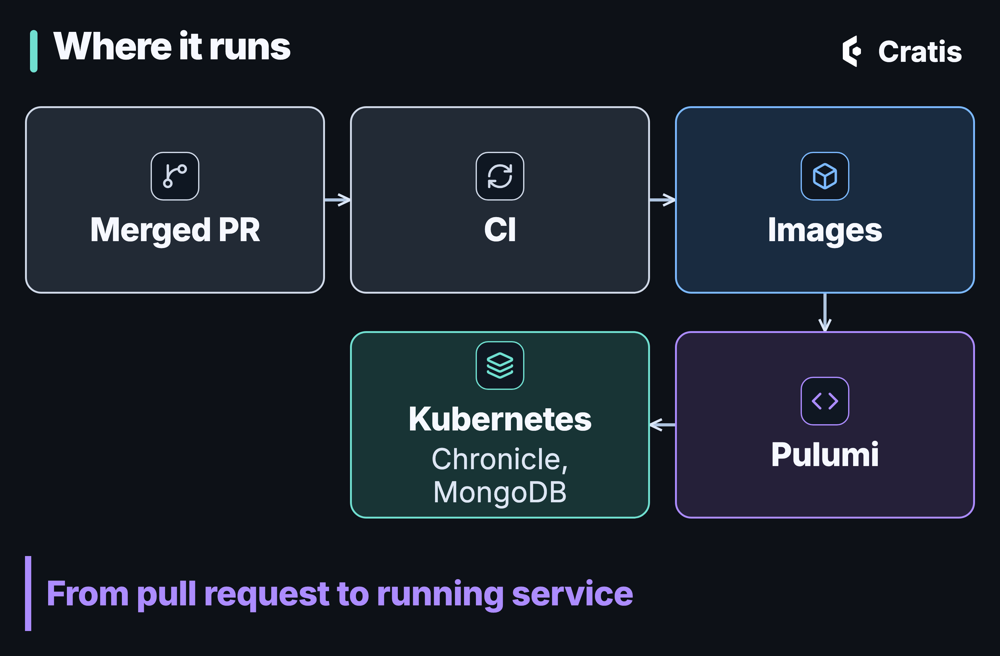

import { Tabs, TabItem } from '@astrojs/starlight/components';

## TL;DR

Cratis Studio is live and in beta. Open signup is coming soon at cratis.studio, with a 14-day free trial. Under the hood it's a handful of services in front of a Chronicle event store: an edge ([AuthProxy](/authproxy-the-edge-your-services-should-not-build/)) that signs you in and works out which organization you belong to, a lobby ([Ante](https://github.com/Cratis/Ante)) that handles invitations, and the Studio application itself. Core, the lobby, the admin console and the catalog each keep their own event store, and they pass each other facts. Studio is built with Chronicle, Arc, Components and the rest of the platform.

## Why show the architecture

Cratis Studio is a collaborative workspace where [people and AI agents design, visualize and edit the same event model](/cratis-studio-event-modeling-together/). That post is about what you can do with it. This one is about what's behind it, because Studio is also a real application built on the same packages you'd install, and I think showing how it's put together is the most honest way to show what those packages are for.

I'll keep this at the level of shapes and responsibilities.

## The shape of it


*The edge sits in front of the product. Chronicle is where the facts live.*

The services, and what each one is for:

| Service | What it does |
| --- | --- |
| **Core** | The product: the event-model board and canvas, projects and domains, live collaboration, the AI agents, Play and code generation, and the people in an organization. |
| **Lobby** | [Ante](https://github.com/Cratis/Ante) as a published image. Invitations and the acceptance of legal terms. |
| **AuthProxy** | The edge. Sign-in, organization and identity for the services behind it. |
| **MCP** | The MCP server Studio offers external AI agents to read and change an organization's event models and brainstorming boards. |
| **Admin** | Internal tooling for running Studio. |
| **Catalog** | The product catalog. |
| **Viewer** | A read-only viewer of an event model. |
| **GitHub integration** | Connects Studio to GitHub. |

There's no separate "workers" service. The background work runs inside Core.

Studio doesn't ship a language model. Cratis Studio's AI agents can generate modules, features and slices from a prompt, explain a domain, feature or module, and answer in chat on the model. They run on a model provider your organization configures, and AI stays off until one is set up.

## The request path


*One path in, one namespace out.*

A request arrives over TLS at the ingress and is handed to AuthProxy. AuthProxy does the work every service would otherwise repeat: it signs the user in through the identity provider, works out which organization they're working in, and forwards the request with the identity and the tenant attached. The [AuthProxy post](/authproxy-the-edge-your-services-should-not-build/) explains how that works and what it asks of the services behind it, and [multi-tenancy and identity end to end](/tenancy-and-identity-end-to-end/), Part 10 of the [series](/from-the-edge-to-the-event-log/), follows the same request all the way down.

What matters for the architecture is what happens next. Studio maps the tenant to a Chronicle namespace, so an organization, a tenant and a namespace are the same thing. Each Chronicle [namespace](https://cratis.io/chronicle/concepts/namespaces/) has its own events, observers and read models, so Studio keeps each organization's events in its own namespace.

Authorization stays in the application. AuthProxy establishes who you are and which organization you're in. Core decides what you're allowed to do, with Arc command and query filters, because the edge doesn't know the rules of the domain and shouldn't.

## Four event stores, and facts between them


*Each service owns its store. Facts cross the boundary as events.*

Studio doesn't have one big event store with every service poking at it. Core, the lobby, the admin console and the catalog each have their own, and they talk the way a reactor reacts inside one store: something happened, and somebody else cares. Chronicle's outbox and inbox carry a fact from one store to another. It means each store's history is about one thing. The cost of that split is the usual one: the owner of a fact has to decide to publish it, and the consumer has to cope with it arriving later.

## The lobby, and one invitation end to end


*Every hand-off in this flow is an event.*

The lobby is where a person who isn't in an organization yet ends up. Studio runs [Ante](https://github.com/Cratis/Ante) for this, which was extracted from Studio's lobby and is published as its own image: it signs invitations, hosts the acceptance screens, and coordinates through events. Walking an invitation through shows how the pieces cooperate.

An organization member invites someone. Core handles `InviteUser` and records `UserInvitedToJoinOrganization`. The email address in that event is personal data, handled the way [personal data in an event log](/personal-data-in-an-event-log/) describes. A unique constraint on the email is checked when the event is appended, so a second invitation to the same address is rejected. A reactor in Core then appends a fact for the lobby's inbox, Ante signs the invitation link and answers with another fact, and Core sends the email. The invitee opens the link, signs in through AuthProxy, and the lobby records that the invitation was accepted. A reactor in Core listens for that and provisions the user inside the organization's namespace, with a role.

Between Core and the lobby, every hand-off in that story is an event, and every step is something you could replay or look at in the log.

## Built on the platform it's for


*The published packages Studio is built with.*

Studio is built with Chronicle, Arc, Components, Fundamentals, AuthProxy and Ante, and its Play and code generation features use Stage, Screenplay and Scene. Stage, Scene and Screenplay are experimental. Some of Studio's own features are still preview or experimental, and that's worth knowing if you try it.

Here's what a small slice looks like. This is registering a project, trimmed down: a command that returns a fact, a constraint that keeps names unique, and a read model that fills itself from the events and exposes a live query.

```csharp
using Cratis.Arc.Commands.ModelBound;
using Cratis.Arc.Queries.ModelBound;
using Cratis.Chronicle.Events;
using Cratis.Chronicle.Events.Constraints;
using Cratis.Chronicle.Projections.ModelBound;
using Cratis.Chronicle.Keys;
using Cratis.Concepts;
using MongoDB.Driver;
using System.Reactive.Subjects;

public record ProjectId(Guid Value) : EventSourceId<Guid>(Value)
{
    public static ProjectId New() => new(Guid.NewGuid());
    public static implicit operator ProjectId(Guid value) => new(value);
}

public record ProjectName(string Value) : ConceptAs<string>(Value)
{
    public static implicit operator ProjectName(string value) => new(value);
}

public record ProjectDescription(string Value) : ConceptAs<string>(Value)
{
    public static implicit operator ProjectDescription(string value) => new(value);
}

[EventType]
public record ProjectRegistered(ProjectName Name, ProjectDescription Description);

[EventType]
public record ProjectRemoved();

[Command]
public record RegisterProject(ProjectName Name, ProjectDescription Description)
{
    public (ProjectId, IEnumerable<EventForEventSourceId>) Handle()
    {
        var projectId = ProjectId.New();
        return (projectId, [new(projectId, new ProjectRegistered(Name, Description))]);
    }
}

public class UniqueProjectNameConstraint : IConstraint
{
    public void Define(IConstraintBuilder builder) => builder
        .Unique(unique => unique
            .WithName("UniqueProjectName")
            .On<ProjectRegistered>(@event => @event.Name)
            .RemovedWith<ProjectRemoved>()
            .WithMessage("A project with this name already exists."));
}

[ReadModel]
[FromEvent<ProjectRegistered>]
[RemovedWith<ProjectRemoved>]
public record Project(ProjectId Id, ProjectName Name, ProjectDescription Description)
{
    public static ISubject<IEnumerable<Project>> AllProjects(IMongoCollection<Project> collection) =>
        collection.Observe();

    public static ISubject<Project> ProjectById([Key] ProjectId id, IMongoCollection<Project> collection) =>
        collection.ObserveById(id);
}
```

The slice targets .NET 10 and the `Cratis` metapackage 22.101.0. That's the whole slice. The command says what happened and nothing else. The name rule is checked by the kernel when the event is appended, not in the command. The read model is built from the events and pushed to the browser as an observable query, which is how the project tree stays current while someone else is editing. Arc generates a TypeScript proxy for the command and the query, and the React side uses it. The post on [read models](/from-event-to-read-model/) and [live UIs with Arc](/live-uis-with-arc/) go through each piece.

A few other places the platform shows up:

- **Concepts, not primitives.** `ProjectName` isn't a string. Fundamentals' `ConceptAs<T>` keeps a project name from being a description by accident, in the command, the event and the read model.
- **Reactors for everything that follows.** Provisioning a user after an acceptance and emailing a link are each a reactor reacting to a fact, [the way Part 4 describes](/reacting-to-facts/).
- **Reducers where the fold is easier as code.** A few read models build their state from events in a method instead of a declaration, for the cases where [a reducer reads better than a projection](/reducers-full-control-persistence-for-free/).
- **Orleans.** The services that need it co-host an Orleans silo, using the shared Cratis Orleans packages.

## What the architecture carries

Three features sit on top of all this.

In Cratis Studio a team brainstorms events on a shared board, models commands, events and read models on one canvas, and sees everyone's cursor as they work. The model itself arrives the way every read model in Studio does, as an observable query.

Cratis Studio has an MCP server that lets external AI agents read and change an organization's event models and brainstorming boards. Studio's own agents go through the same surface, so there's one way in to the model, whether the caller is a person's assistant or Studio's.

A Cratis Studio event model can be exported as Screenplay text, Mermaid or JSON and imported back from Screenplay with a preview. Slices can carry Given/When/Then specifications, and Play runs the model in a disposable Stage session.

## Where it runs



*From merged pull request to running service.*

Studio runs on a managed Kubernetes cluster, built from container images, one per service. The infrastructure is code, written with [Pulumi](https://www.pulumi.com/) in C#.

The Chronicle kernel is the public `cratis/chronicle` image running as a deployment, with MongoDB behind it for storage. The [running Chronicle in production](/running-chronicle-in-production/) post covers that setup, and [personal data in an event log](/personal-data-in-an-event-log/) covers how personal data is encrypted and erased. Telemetry flows out through OpenTelemetry.

## What I'd take from it

You don't need Studio's size to use any of this. The parts that travel are small:

- **Make the organization a namespace.** If your tenant is a Chronicle namespace, each tenant's events, observers and read models live in their own namespace.
- **Give each service its own event store.** The history of the lobby should be about invitations, and the history of Core about the product. Let facts cross the line, and decide who owns each one.
- **Put the repeated work at the edge, keep the decisions in the service.** AuthProxy signs people in and finds their organization. The application decides what they can do.
- **Let slices be small.** A command, an event, a constraint and a read model fit in one file, and most of Studio is that.

If you want to see the result, [Cratis Studio](https://cratis.studio) is live and in beta. The parts you can use yourself are documented at [cratis.io](https://cratis.io): [Chronicle](https://cratis.io/chronicle/), [Arc](https://cratis.io/arc/) and [AuthProxy](https://cratis.io/authproxy/). Come and say hello on [Discord](https://discord.gg/kt4AMpV8WV) if something here made you want to know more.
