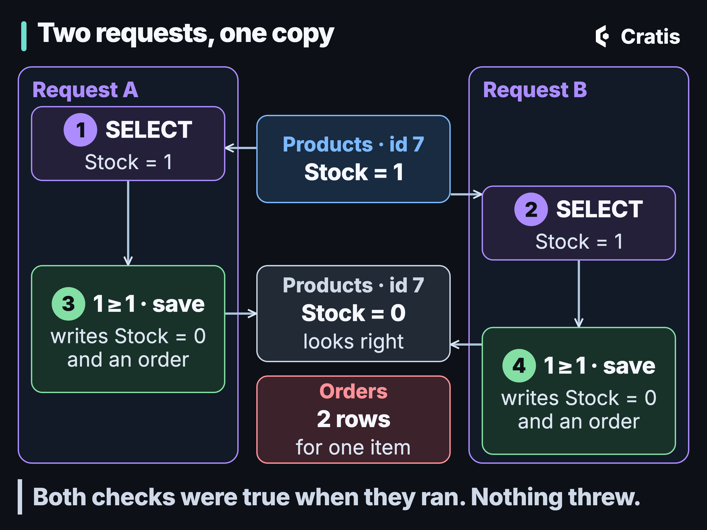

*[Decisions that hold](/the-bug-you-never-see/) · Part 01 of 11*

Is there a copy left? Is this user name free? Is the balance enough for the withdrawal? Is the 10:30 slot still open? Has this customer already used the welcome discount?

Most applications are full of questions like these, and each one is half of a decision. The code reads something, checks it, and then writes. Between the read and the write there is a gap, and in most code nothing connects the write to what the read saw. Two requests can both read "yes", both pass the check, and both write.

This series is about making those decisions hold. This first part is about the problem itself, because in my experience it's one of the most common bugs in business software and one of the least discussed. It doesn't throw and it doesn't show up in tests. When it does surface, it rarely looks like a bug.

## Two requests for the last copy

Here is the code most of us have written, in some form, many times. An order is accepted only while there is stock:

```csharp
using Microsoft.EntityFrameworkCore;

public class Product
{
    public int Id { get; set; }
    public int Stock { get; set; }
}

public class Order
{
    public int Id { get; set; }
    public int ProductId { get; set; }
    public int Quantity { get; set; }
}

public class ShopContext(DbContextOptions<ShopContext> options) : DbContext(options)
{
    public DbSet<Product> Products => Set<Product>();
    public DbSet<Order> Orders => Set<Order>();
}

public class PlaceOrder(ShopContext db)
{
    public async Task<bool> Handle(int productId, int quantity)
    {
        var product = await db.Products.SingleAsync(p => p.Id == productId);
        if (product.Stock < quantity)
        {
            return false;
        }

        product.Stock -= quantity;
        db.Orders.Add(new Order { ProductId = productId, Quantity = quantity });
        await db.SaveChangesAsync();
        return true;
    }
}
```

It reads well, and every test of it passes. Now take a product with one item left and two customers who press **Buy** within a few milliseconds of each other:

```text
request A                                   request B
SELECT product 7: Stock = 1
                                            SELECT product 7: Stock = 1
1 >= 1, set Stock = 0, add an order
SaveChanges: UPDATE Stock = 0, INSERT order
                                            1 >= 1, set Stock = 0, add an order
                                            SaveChanges: UPDATE Stock = 0, INSERT order

Products: Stock = 0      Orders: two rows for product 7
```



*Both checks were right when they ran. The row says 0, and two orders exist for one item.*

Both requests succeed. EF Core sends the new value of the property, so both updates write `Stock = 0`, and the second one overwrites the first. The stock column looks exactly right. The only trace is a second order for an item that was never there, and it appears as a successful request in every log.

That's the classic lost update. Microsoft's [locking and row versioning guide](https://learn.microsoft.com/en-us/sql/relational-databases/sql-server-transaction-locking-and-row-versioning-guide) defines it in one sentence: lost updates "occur when two or more transactions select the same row and then update the row based on the value originally selected."

## Why you never see it

The gap is small, often a few milliseconds, and almost everything about how we build and test software keeps two requests out of it.

- **Tests run one request at a time.** A test of `PlaceOrder` calls it, checks the result, and stops. A second call that starts after the first has finished reads the new stock and is correctly rejected.
- **Development has one user.** You can't double-book a slot you're the only person looking at.
- **It doesn't need two users.** A double-clicked button, an HTTP client that retries after a timeout, a load balancer that resends, a message delivered twice: each of these is two requests carrying the same intent, and they arrive close together by construction.
- **Nothing fails.** No exception, no error log, no alert. Every request returned success.
- **The result looks like bad data.** A negative balance, a member with four loans when the limit is three, two bookings for one room. Someone fixes the row by hand, and nobody connects it to the code.
- **It surfaces late.** Support hears about it from a customer, or finance finds it in a reconciliation weeks later, long after the logs that would explain it have rotated.

So the bug survives code review, testing and staging, and shows up in production, most often under load on the busiest day or when a retry lands in the gap, where it's hardest to reproduce.

## Doesn't the database handle this?

It's a reasonable assumption, and it's mostly wrong for the default settings.

First, look at where the transaction is. In the code above, EF Core runs `SingleAsync` as its own statement. [By default](https://learn.microsoft.com/en-us/ef/core/saving/transactions), "all changes in a single call to `SaveChanges` are applied in a transaction", and that transaction begins after the read. The read and the write are in different transactions, so no isolation level on the write can protect a value read before it began.

Second, even with one transaction around both, the default isolation levels don't stop this:

- PostgreSQL: "[Read Committed](https://www.postgresql.org/docs/current/transaction-iso.html#XACT-READ-COMMITTED) is the default isolation level".
- SQL Server: [`READ COMMITTED`](https://learn.microsoft.com/en-us/sql/t-sql/statements/set-transaction-isolation-level-transact-sql) "is the SQL Server default", and under it "data can be changed by other transactions between individual statements within the current transaction". Azure SQL Database turns on `READ_COMMITTED_SNAPSHOT` by default, which changes how reads are served, not this.
- MySQL: [`REPEATABLE READ`](https://dev.mysql.com/doc/refman/8.4/en/innodb-transaction-isolation-levels.html) "is the default isolation level for InnoDB".

Here is what each does when both requests run the read and the update inside one transaction, and the new stock is computed in application code:

| Isolation level | What the second request's `UPDATE` does |
| --- | --- |
| PostgreSQL `READ COMMITTED` (default) | Waits for the first transaction to commit, then writes its own value over it |
| SQL Server `READ COMMITTED` (default) | The same |
| MySQL InnoDB `REPEATABLE READ` (default) | The same. The `SELECT` reads a snapshot, but the `UPDATE` works on the latest row |
| PostgreSQL `REPEATABLE READ` or `SERIALIZABLE` | Fails with "could not serialize access due to concurrent update", and the application has to retry the transaction |
| SQL Server `SNAPSHOT` | Fails with error 3960, "Snapshot isolation transaction aborted due to update conflict", and the application has to retry |

The MySQL row surprises people, because "repeatable read" sounds like protection. The [manual](https://dev.mysql.com/doc/refman/8.4/en/innodb-consistent-read.html) is explicit that "the snapshot of the database state applies to `SELECT` statements within a transaction, not necessarily to DML statements", and its [locking reads page](https://dev.mysql.com/doc/refman/8.4/en/innodb-locking-reads.html) opens with the exact case: "If you query data and then insert or update related data within the same transaction, the regular `SELECT` statement does not give enough protection."

So the stronger levels do catch this lost update, as an error you have to handle. They catch it because both requests update the same row. Many rules don't work that way.

## The rule nobody writes to

Say a library member may hold at most three loans. The check counts rows and the act inserts one:

```sql
-- Both requests run this for member 42, who has two active loans.
BEGIN;
SELECT count(*) FROM loans WHERE member_id = 42 AND returned_at IS NULL;  -- 2, so below 3
INSERT INTO loans (member_id, book_id) VALUES (42, 1001);                 -- the other request inserts 1002
COMMIT;
```

Both requests see two loans, both insert, and the member now holds four. Neither transaction updated a row the other one touched, so there is no update conflict to detect and no unique key to collide. This is **write skew**: each transaction decides from data the other one is changing. The [PostgreSQL wiki](https://wiki.postgresql.org/wiki/SSI) defines it as two concurrent transactions that "each determine what they are writing based on reading a data set which overlaps what the other is writing".

Snapshot isolation allows it. PostgreSQL's `REPEATABLE READ` is implemented as snapshot isolation, and its [documentation](https://www.postgresql.org/docs/current/transaction-iso.html#XACT-SERIALIZABLE) shows the same shape with two sums and two inserts, where "if either transaction were running at the Repeatable Read isolation level, both would be allowed to commit." Its [Repeatable Read section](https://www.postgresql.org/docs/current/transaction-iso.html#XACT-REPEATABLE-READ) also says plainly that "attempts to enforce business rules by transactions running at this isolation level are not likely to work correctly without careful use of explicit locks." SQL Server's `SNAPSHOT` [checks for conflicts](https://learn.microsoft.com/en-us/sql/relational-databases/sql-server-transaction-locking-and-row-versioning-guide) on the rows a transaction modifies, and the two loan inserts modify different rows, so both commit there as well.

Write skew is the general shape of most check-then-act rules: a limit counted over rows, an overlap between bookings, "at least one person on call", "only one active subscription", "no more than 5000 withdrawn this month". The check reads a set and the act adds to it.


*The check and the act are separate moments. Every fix is a way of tying the second to what the first saw.*

## The usual fixes, and where each stops

There are good tools for this in a relational database. Each one covers a particular shape of rule.

**A unique constraint** makes uniqueness hold for every writer. In PostgreSQL's words, [unique constraints](https://www.postgresql.org/docs/current/ddl-constraints.html#DDL-CONSTRAINTS-UNIQUE-CONSTRAINTS) "ensure that the data contained in a column, or a group of columns, is unique among all the rows in the table." It is the right answer for "is the name free?", and the `SELECT`-then-`INSERT` check in front of it becomes a friendly message, not the rule. It can't count or sum. PostgreSQL's [exclusion constraints](https://www.postgresql.org/docs/current/ddl-constraints.html#DDL-CONSTRAINTS-EXCLUSION) extend the idea to overlaps such as bookings, but not to "at most three".

**A conditional write** moves the check into the statement that acts:

```csharp
using Microsoft.EntityFrameworkCore;

public class PlaceOrderConditionally(ShopContext db)
{
    public async Task<bool> Handle(int productId, int quantity)
    {
        await using var transaction = await db.Database.BeginTransactionAsync();

        var reserved = await db.Products
            .Where(p => p.Id == productId && p.Stock >= quantity)
            .ExecuteUpdateAsync(s => s.SetProperty(p => p.Stock, p => p.Stock - quantity));

        if (reserved == 0)
        {
            return false;
        }

        db.Orders.Add(new Order { ProductId = productId, Quantity = quantity });
        await db.SaveChangesAsync();
        await transaction.CommitAsync();
        return true;
    }
}
```

That is `UPDATE products SET stock = stock - @quantity WHERE id = @id AND stock >= @quantity`, and `ExecuteUpdateAsync` [returns the number of rows affected](https://learn.microsoft.com/en-us/ef/core/saving/execute-insert-update-delete#concurrency-control-and-rows-affected). Under PostgreSQL's `READ COMMITTED`, a second update that waited for the first sees the new row, and "the search condition of the command (the `WHERE` clause) is re-evaluated", so it matches nothing. It works as long as the whole rule fits in the `WHERE` clause of one row. Under `REPEATABLE READ` the same statement fails with a serialization error and you retry.

**A concurrency token** is EF Core's [optimistic concurrency](https://learn.microsoft.com/en-us/ef/core/saving/concurrency). Mark a property with `[ConcurrencyCheck]`, or map a SQL Server `rowversion` with `[Timestamp]`, and EF Core adds its original value to the `WHERE` clause of the update, so the update "only modifies the row if the `Version` column hasn't changed since the moment we queried it." A conflict throws `DbUpdateConcurrencyException`, and resolving it, including any retry, is your code. It fixes the lost update in `PlaceOrder`. It covers only rows you update or delete: the docs note the exception "is generally never thrown when adding entities", so a token on the rows you insert does nothing for the loan count. A version on the parent row does work, if every writer that adds a loan also bumps the member's version: two concurrent inserts then both update the member row, and the second one gets the exception. It's the optimistic form of the parent-row lock below, with the same every-writer condition.

**A locking read**, `SELECT ... FOR UPDATE`, holds the rows it returns until the transaction ends. In [PostgreSQL](https://www.postgresql.org/docs/current/explicit-locking.html#LOCKING-ROWS) it "causes the rows retrieved by the `SELECT` statement to be locked as though for update." A row that doesn't exist yet isn't returned, so it isn't locked. MySQL's `REPEATABLE READ` adds gap locks over the index range a locking read scans, which do block inserts into it, and PostgreSQL doesn't. The common pattern for a rule over many rows is to lock a parent row, the member, as a mutex. That holds only while every code path that can break the rule takes the same lock first and checks the rule after it, and it costs waiting and the occasional deadlock. Under PostgreSQL's `REPEATABLE READ` even that isn't enough: the snapshot is fixed when the transaction's first query starts, and the [docs](https://www.postgresql.org/docs/current/applevel-consistency.html) warn that "if the snapshot seen by the transaction predates obtaining the lock, it might predate some now-committed changes in the table". The count after the lock can still miss the other request's loan, so take the lock at `READ COMMITTED`.

**Serializable transactions** handle write skew in PostgreSQL. Its `SERIALIZABLE` level monitors read/write dependencies and rolls one transaction back with SQLSTATE `40001`. The [docs](https://www.postgresql.org/docs/current/applevel-consistency.html) set the conditions: it works "if the Serializable transaction isolation level is used for all writes and for all reads which need a consistent view of the data", and the application needs a framework that retries transactions rolled back with a serialization failure. SQL Server and MySQL implement `SERIALIZABLE` with locks, so the same pattern tends to block or deadlock instead, and the losing transaction still has to be retried.

Put together: a constraint when the rule is uniqueness or exclusion, a conditional write when the rule fits in one row, a token when the danger is overwriting a row someone else changed. For rules that span rows or tables, and rules over history ("three in any 30 days", "5000 per month"), you're left with locks, a version on a parent row, or serializable transactions, and all of them depend on every writer following the same protocol. None of them is the default, and none of them is visible in the `PlaceOrder` code above.

## Event sourcing doesn't make it go away

You might expect event sourcing and CQRS to sidestep this. They make it more common.

In many CQRS codebases, including the Arc style this series uses, the side that decides asks a read model: a projection built from the events. Read models are built after the fact. Chronicle's [documentation](https://cratis.io/chronicle/projections/eventual-consistency/) says it directly: "read models are updated asynchronously as events are processed", and the append returns before the projection has run. So a command that checks a read model and then appends has the same gap as `PlaceOrder`, plus the projection's lag. Two requests don't even have to overlap. A request that arrives after the first one has completed can still read the old stock and be approved.

Folding the state fresh from the events doesn't close it either. A fresh read is a correct snapshot of the moment it was taken, and an append that follows it is not conditioned on it. A stream's expected version helps when the rule lives entirely in the one stream you append to. It says nothing about a read model built from other events, or about a second entity the rule depends on.

Arc is no exception. With read protection Off, [which is the default](https://cratis.io/arc/backend/csharp/chronicle/consistency/), "an injected read model is a plain read, it returns a snapshot, and it guards nothing." The next part starts from exactly that command.

What event sourcing does give you is a way to say what the decision depended on. An event log is ordered, and every event has a position. A decision can note the position before it reads, fold the events it needs, and append with a condition: only if no event that would have changed what I read has arrived since. That's not a lock. Nothing waits, and a conflict is an answer: the state changed, read again and decide again. The condition can be as narrow as the rule: the event types that build this read model, for this key. The rest of the series is about that condition, how to get one, and where it stops.

:::tip[How to spot it in your own code]

Look for any rule that reads state before it writes:

- A query followed by `SaveChanges` in the same handler: `SingleAsync`, `FirstOrDefaultAsync`, `AnyAsync` or `CountAsync`, then `Add` or a property change.
- A value computed in application code from a value you read: `product.Stock -= quantity`, `account.Balance -= amount`.
- `if (!await db.Users.AnyAsync(u => u.Email == email))` followed by an insert.
- Words in the requirement such as "at most", "no more than", "only one", "once", "per month", "still available".
- A validator, cache, search index or read model consulted before a command writes.
- Anything that can arrive twice: a submit button, a client retry, a redelivered message.

For each one, ask what happens if two of them run at the same moment, and what ties the write to what the check read:

- Uniqueness → a unique constraint or index; the check in front is only the message.
- One row's state → a conditional `UPDATE ... WHERE` and a rows-affected check, or a concurrency token.
- Many rows or tables → a lock every writer takes before it checks (at `READ COMMITTED` in PostgreSQL), a version on a parent row every writer bumps, or serializable transactions with retries.
- A read model before an append → the append needs a condition on what was read; Part 2 covers how Arc and Chronicle express one, and where it stops.
- Nothing ties them → you have the bug. It just hasn't been reported yet.

:::

## The series

*Decisions that hold* is eleven posts on making a decision still true at the moment it's written, mostly in Arc and Chronicle, with the limits of each mechanism stated where it applies.

1. [The bug you never see](/the-bug-you-never-see/). Check-then-act decisions, why two requests can both pass the check, and what the database defaults do about it.
2. The read model said yes. A command that checks a read model and then appends, and what it takes in Arc and Chronicle for that check to still hold at the append.
3. One rule, two entities, one append. A rule over a member and a book: two reads, one fact for each entity, and one atomic append.
4. A limit for one account and one month. Guarding a decision on one stream, so last month's activity doesn't conflict with today's.
5. When Arc says no. The two kinds of refusal, what each means, and what the caller and the UI should do.
6. Turning read protection on in an application that already runs. Measuring first, fixing what it finds, and switching on per project.
7. Not every rule needs a guarded read. Constraints, aggregates, explicit scopes, stream decisions, repair and hints, and the choices that fail silently.
8. The same guard without Arc: decision reads and append conditions. The Chronicle calls underneath, and how they map to the dynamic consistency boundary.
9. Testing a decision against a race. Putting a competing write between a command's read and its commit.
10. How a guard is built, merged and widened. Predicting exactly which events make a command fail.
11. Decisions that hold: questions and a decision guide. One page to come back to.

If you've read *Cratis: from script to stage*, its parts on [rules that hold when you write](/rules-that-hold-when-you-write/) and [validation all the way down](/validation-all-the-way-down/) covered constraints, concurrency scopes and validators. This series goes further into the decisions that read state first.

Next is Part 2, *The read model said yes*: the same last-copy race as a library command in Arc, and what changes, and what doesn't, when the read it checks is tied to the append.
